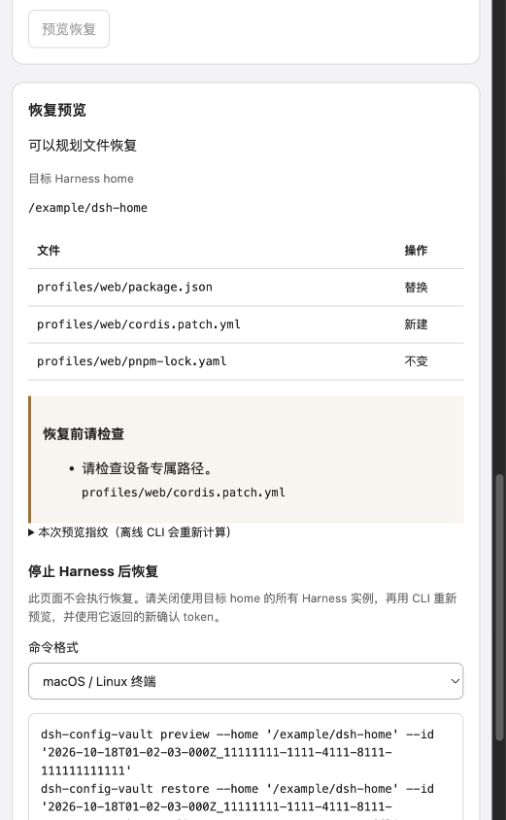

# DSH Sync

项目名 **DSH Sync**，npm 包名 **`@jeweis/dsh-sync`**，CLI 命令 **`dsh-sync`**，独立目录 `plugins/dsh-sync`。从 `dsh-config-vault` 改名时保留旧 CLI 别名、配置目录、凭据引用与数据格式；详见 [改名兼容说明](docs/branding.md)。未自动迁移任何已安装的 profile。

DeepSeek Harness 的 WebDAV 配置同步、自动备份与离线恢复插件。设置页统一为“同步与备份”。当前版本 `0.9.0` 针对 Harness `0.2.1-rc.2`，默认加密，可显式选择明文。宿主和 CLI 使用原生 ESM，设置页构建为 Harness lazy-CJS 客户端模块。名称与图标说明见 [品牌与元数据](docs/branding.md)。项目方案见 [第一版设计](docs/design-v1.md)、[设置页方案](docs/settings-ui.md)、[自动备份说明](docs/automatic-backup.md) 和 [保留策略](docs/retention.md)。

版本支持和升级说明见 [运行时兼容性](docs/compatibility.md)。`0.2.0` 的 alpha.5 依赖约束不适用于 rc.2，请更新插件包而非设置版本豁免。

## 第一版范围

- 选择 profile，备份其 `package.json`、原始 `cordis.patch.yml` 及存在时的 `pnpm-lock.yaml`，保留插件依赖、bundle 顺序、注释和 `!!js` 表达式。
- 可选备份 home 的 `cordis.patch.yml`，默认关闭，因为它经常包含设备设置。
- 远端快照默认使用 scrypt + AES-256-GCM 加密，可显式关闭；本地回滚记录始终加密。
- 上传独立快照、下载认证校验、列出历史、零写入恢复预览、确认后离线应用、失败回滚、进程中断后恢复。
- 不采集凭据文件、环境文件、会话、附件、缓存、`node_modules`、Skills 或个人指令。配置文件内直接写入的密钥仍会被包含，关闭加密后也会明文存放。
- 支持手动快照及可选的变更后自动备份，不是双向实时同步；默认保留本设备最近 30 份有归属记录的快照，不自动恢复。

## 安装和接入

本项目是 `plugins/` 下的独立 Git 仓库；安装依赖、测试及打包均在本目录执行。开发依赖包含已发布的 Harness 库，用于真实 Cordis 生命周期和工具流水线测试，无需构建上游源码：

```sh
npm ci --ignore-scripts
npm run build
npm test
npm run check
npm pack --dry-run
```

使用正式打包文件前可执行 `npm pack`。需要时由用户将该插件安装到选择的 profile，示例（正式发布后可使用 npm 包名，目前使用本地包）：

```sh
dsh plugin --profile web add /path/to/dsh-sync
```

这是接入说明，开发测试不会执行该命令。宿主提供共享 `@deepseek-ai/dsh-tools` 和 Cordis 实例；独立 CLI 不导入这些模块。插件通过 bundle patch 加载，注册 `vault_backup`、`vault_list`、`vault_preview` 三个工具。`vault_backup` 会写远端，仅在用户要求备份时使用。运行中的插件不提供覆盖 profile 的工具；恢复通过离线 CLI 完成。

可在 profile patch 配置：

```yaml
- id: dsh-config-vault
  config:
    profiles: [web]
    includeHomePatch: false
    timeoutMs: 30000
```

连接信息可在设置页保存，也可通过环境变量提供初始值；见 [.env.example](.env.example)。手动加密操作按次输入口令，自动加密模式可显式解锁并只在当前宿主进程暂存；模型工具和 CLI 的加密口令从环境读取。明文备份/预览无需口令。CLI 不自动加载 `.env`，本地开发可以使用 Node `--env-file=.env`，确保该文件保持忽略。

| 环境变量 | 用途 |
| --- | --- |
| `DSH_VAULT_WEBDAV_URL` | HTTP 或 HTTPS WebDAV 备份目录；首次上传递归创建目录 |
| `DSH_VAULT_WEBDAV_USERNAME` | Basic Auth 用户名 |
| `DSH_VAULT_WEBDAV_PASSWORD` | WebDAV 应用密码 |
| `DSH_VAULT_PASSPHRASE` | 12–1024 字符的加密口令；请使用高强度口令并另外保存 |

口令不会写入快照、模型工具参数或输出。新设备需要自行设置同一口令及远端连接信息。丢失口令无法恢复；第一版不支持持久化口令、密钥找回或轮换。

## 设置页

安装并启用插件后，设置中出现独立的 **同步与备份** 页面（中英文随 Harness 语言切换）。本项目开发时没有安装到真实 profile。

1. 填写 HTTP 或 HTTPS WebDAV 目录、用户名和应用密码，选择本机可用的 profile，保存配置。密码留空保留当前值；可明确移除本地凭据，但环境变量仍可能作为回退来源。
2. 测试连接。此操作以只读请求确认快照目录是否存在，不存在时明确提示备份时尝试自动创建；尚不证明有上传权限，也不会在测试时创建目录。
3. 保持默认“加密备份”并输入口令，或明确关闭加密选择明文，再点击“立即备份”；上传后下载校验，成功才显示完成。手动口令提交后清除。
4. 加载快照，选择一项，再次输入该快照的口令后预览。列表来自对象名称，内容在预览时才被认证。
5. 检查文件新建/替换/不变动作，以及设备路径、版本、本地插件依赖等提示。页面提供 POSIX / PowerShell 离线操作指引，没有在线恢复按钮。关闭目标 home 的全部实例后，在 CLI 重新预览并使用新的 token 确认。

未保存的表单修改会禁用远端操作；重新加载会丢弃草稿。过期 revision 会拒绝保存。丢失备份响应不会自动重复上传，而是提示先查看远端快照确认结果。

0.2.3 起，备份失败会显示读取配置、加密、MKCOL 建目录、PUT 上传、GET 下载或认证校验阶段，以及适用的 HTTP 状态码。0.2.4 起，缺失快照目录的 404 会明确提示，不再显示“连接可读取”；备份先确认最近的已有目录，再自上而下创建缺失目录，避免对已有 NAS 共享/挂载祖先执行 MKCOL。405/409 只有经再次读取确认目录存在才继续。地址应是 WebDAV 对外目录，不能假定 NAS 内部磁盘路径就是 WebDAV 路径。建目录或本机采集失败会明确显示未上传；PUT 开始后的失败仍要求先查看快照。诊断只返回固定阶段/原因/状态码，不包含密码、配置正文、服务器响应正文或原始异常。遇到 MKCOL/PUT 权限错误，请检查 URL 是否指向账号可写的共享目录。

非秘密偏好保存于当前 Harness home 的 `config-vault/settings.json`，优先于环境默认值，且不纳入备份。WebDAV 密码通过 Harness credentials 服务使用 `DSH_VAULT_WEBDAV_PASSWORD` 引用保存，从不回传前端。口令不写入文件、浏览器共享状态或响应；显式解锁的自动备份口令可暂存在宿主进程。模型工具下一次操作读取已保存的连接、范围与加密模式；加密模式仍要求进程环境提供口令。

0.2.5 起，HTTP 与 HTTPS 均直接支持，不需要额外环境开关；设置页、模型工具和离线 CLI 共用这一规则。HTTP 不加密连接，Basic Auth 用户名和密码可能被截获，设置页会显示提示。建议优先使用 HTTPS，插件不会自动从 HTTPS 降级或跟随重定向。NAS 的 HTTP 端口可能与 HTTPS 不同，请填写服务实际配置的端口和 WebDAV 路径。

### 配置变更后自动备份

在设置页开启并保存，默认等待配置稳定 **30 秒**，两次自动尝试至少间隔 **5 分钟**；两项均可调整。每 5 秒读取已选文件并计算内容哈希，未变化时不解析 YAML、不写锁文件、不请求网络；上传前仍完整校验。性能测量见 [轮询性能](docs/polling-performance.md)。连续编辑合并处理，相同内容跳过，正常重启后仍能去重。手动成功备份也更新去重记录。加密模式需在页面解锁本次运行的自动口令，或由进程环境提供；未解锁时明确暂停。明文模式无需口令。

首次开启会在等待期后创建初始快照。只在 Harness 运行时工作，关闭浏览器页面仍继续；关闭开关后停止后续自动上传。上传结果不确定时暂停，先检查快照再恢复自动尝试，防止重复 PUT。恢复继续通过离线 CLI 确认。完整语义与明文模式的限制见 [自动备份说明](docs/automatic-backup.md)。

0.3.0 已完成官方 DSH rc.2 临时 profile 的浏览器验收：自动加密、变更合并、重启等待口令、明文自动备份和关闭开关均通过，见 [0.3.0 验收记录](docs/acceptance-030.md)。

### 快照保留策略

设置页“本设备保留的最近快照数”默认 **30**，可设为 1–10000；手动、自动及 CLI 备份均在新对象上传并下载校验成功后执行。只处理当前 home/device 在同一远端目录和账号下有本机上传凭据的旧对象。旧版本无记录的快照和其他设备对象不自动删除。降低数量不会立即删除文件，需等待下一次成功备份。

清理前核对原上传内容哈希，并使用强 ETag 的条件 DELETE；缺少支持、权限不足、文件被替换或本地归属记录损坏时保留数据并提示，**不会把备份成功改报失败**。每次最多处理 50 个旧对象，超出部分留待下次成功备份，所以数量在异常或积压时可能暂时超限。CLI 可用 `--keep-last COUNT` 覆盖该次策略。归属记录不纳入快照，新设备不能自动接管旧设备数据。详见 [保留策略](docs/retention.md)。

官方 DSH rc.2 临时 profile 的真实设置页和已安装 CLI 已完成保留策略往返，见 [0.4.0 验收记录](docs/acceptance-040.md)。

离线 CLI 在提供 `--home` 时读取该 home 中已保存的连接与范围。它不自动打开 Harness 凭据存储；请在执行终端另外提供 `DSH_VAULT_WEBDAV_PASSWORD`（匿名 WebDAV 除外）和 `DSH_VAULT_PASSPHRASE`。这两项秘密值均不进入界面生成的命令。

设置 API 通过 Harness Connection 的 `/api/dsh-config-vault/state`（GET、buffered）及 `/api/dsh-config-vault`（POST、streaming）exact Fetch routes 提供，由现有通道负责鉴权、Host/Origin 检查和 owner 权限，同时兼容 Web/桌面载体。缺少 Connection、credentials 或 profileContext 的 headless 组合不提供设置路由，备份工具仍可使用。

### 不安装插件即可预览界面

```sh
npm run preview:ui
```

脚本输出一个仅监听 `127.0.0.1` 的临时地址。该页面运行实际构建的客户端 UI，但使用内存模拟响应，不读取 Harness home、不访问 WebDAV。请勿在模拟页面填写真实凭据，按 Ctrl+C 结束。模拟恢复预览截图：



## CLI 使用

以下命令均从插件目录执行，路径使用占位符，不包含机器专属配置。CLI 的 `--home` 必须显式指定。

```sh
# 从环境变量指定的 WebDAV 读取连接信息
node src/cli.mjs backup --home /path/to/source-dsh-home --profiles web,headless
node src/cli.mjs list

# 下载认证并预览：不创建目标文件，返回确认 token
node src/cli.mjs preview --home /path/to/target-dsh-home --id SNAPSHOT_ID

# 关闭所有使用该目标 home 的 Harness/桌面进程后，使用刚预览的 token
node src/cli.mjs restore --home /path/to/target-dsh-home --id SNAPSHOT_ID --confirm PLAN_TOKEN --offline
```

`--offline` 是调用者对目标已停止运行的明确声明，CLI 无法自动证明所有外部进程已退出。home 级 patch 可能影响多个 profile，因此应关闭使用该 home 的全部实例。CLI 的锁只能阻止本插件的另一次恢复，无法锁住手工编辑或 Harness 自身的配置编辑器。

恢复为**覆盖快照内列出的文件**，不删除目标上额外的 profile/patch/lockfile，不合并 JSON/YAML，不自动重映射设备路径。预览只输出路径、哈希、动作和提示，不输出配置正文。设备路径与可执行 `!!js` 会提示；本地 `file:`/`link:` 插件和版本不匹配会阻止应用。需要先手工迁移这些插件，再生成可迁移快照。

### 插件依赖恢复

本版恢复的是配置文件，不会下载插件、执行安装脚本、覆盖构建授权或宣称环境已可用。恢复结果明确返回 `dependenciesInstalled: false`。**在保持目标 Harness 关闭的情况下**审阅恢复后的依赖清单，再使用现有 DSH CLI 安装依赖：

```sh
# 必须让 DSH_HOME 指向与 --home 相同的目标；不要误操作默认 home。
DSH_HOME=/path/to/target-dsh-home dsh plugin --profile web install
```

每个恢复的 profile 分别执行。私有 registry、代理与构建脚本授权需在目标设备重新配置。本版不自动迁移这些授权。之后启动对应 Harness 验证模型、插件及 MCP；仅完成文件恢复不代表插件安装或兼容性验证成功。

备份保留原始版本声明及已有 lockfile；不存在 lockfile 或使用版本范围/Git 分支时不保证精确重建，预览会提示非精确依赖。`--runtime-version` 记录或声明 Harness 版本（默认目标版本），并不是自动检测本机版本或逐包兼容性求解。请以 `dsh --version` 的真实结果为准。

## 回滚与中断恢复

每次实际恢复前，在目标 `config-vault/` 下保存加密事务日志（包含原文件或“原本不存在”）。它不包含口令。恢复正常失败时尝试还原；进程突然退出时保留 `active.vault`。

```sh
# 中断后的恢复预览，完全不依赖远端可用性
node src/cli.mjs recover --home /path/to/target-dsh-home
node src/cli.mjs recover --home /path/to/target-dsh-home --confirm RECOVERY_TOKEN --offline

# 成功恢复后，使用结果给出的 rollbackId 回退
node src/cli.mjs recover --home /path/to/target-dsh-home --rollback TRANSACTION_ID
node src/cli.mjs recover --home /path/to/target-dsh-home --rollback TRANSACTION_ID --confirm RECOVERY_TOKEN --offline
```

如果恢复后有人修改了文件，回滚会拒绝覆盖这些新内容。崩溃遗留锁只在原进程 PID 已不存在时可由恢复命令移除。若崩溃发生在日志写入前，且没有 `active.vault`，请先检查遗留锁确认没有活动操作，再手工移除 `config-vault/restore.lock`；该阶段尚未写配置文件。

本地回滚事务日志不自动清理；远端快照按上述本设备保留策略维护。无归属记录、其他设备或无法安全删除的快照仍需自行管理。

## 验证边界

`npm test` 使用临时 home、本地 WebDAV 模拟服务、真实 Cordis/工具/Connection 库及 jsdom 设置页交互测试，不会安装到真实 profile，也不使用个人 WebDAV。另有浏览器模拟页用于视觉检查。已完成官方 rc.2 临时 profile 的真实启动与浏览器验收，见 [验收报告](docs/acceptance-rc2.md)。真实 Nextcloud/坚果云/NAS 和 Windows/macOS/Linux 全矩阵仍需另外执行。HTTP 与 HTTPS 均支持；不跟随重定向，不自动读取代理环境变量。

文件上限 2 MiB，快照最多 128 文件、明文总量/序列化载荷最多 16 MiB。回滚日志包含 before/after 双份内容，也受 16 MiB 限制；过大时在写入目标配置之前失败。当前防护拒绝受管路径中的符号链接；同一宿主上恶意并发替换祖先目录不属于此版本可保证的隔离范围。

## WebDAV 双设备同步（0.8.0）

在两台设备的“同步与备份”页面保存同一 WebDAV 地址、同步空间和同步范围，分别解锁相同的独立加密口令。首次检查先比较并选择本机或云端；之后默认每 3 分钟核对一次。主题/字体/字号、语言、默认模型和已支持的 DeepSeek 参数通过 Harness 在线配置接口生效；并发冲突暂停等待选择。只同步当前运行 profile 的支持字段，独立于备份 profile 选择。

同步始终加密。供应商 API Key 使用独立开关，默认关闭，开启后仅通过 Harness 凭据服务加密同步，预览不显示密钥。支持官方 DeepSeek 与 pi-ai 的 API Key 引用加密上传，引用接入[可选原子凭据 provider](docs/atomic-credentials.md)后可自动接收并拒绝过期写入，普通 provider 继续手动接收保护；pi-ai Key 记录仍可原子双向同步。OAuth、登录状态、环境变量包、请求端点、本地路径、任意插件配置、MCP/技能文件不纳入同步。插件清单可同步查看，差异不会触发自动安装、卸载或文件恢复。完整快照恢复依旧离线确认。WebDAV 需要通过强 ETag 和条件写检查；不支持时暂停设备同步，普通备份仍可使用。

操作步骤、边界与测试见 [双设备同步](docs/device-sync.md)；引用型 Key 防覆盖及官方 rc.2 服务验收见 [0.7.0 验收](docs/acceptance-070.md)。

## 可选增强：引用型 API Key 自动接收（0.8.1）

默认直接使用现有 Harness 凭据服务，配置同步、备份及 Key 加密上传无需切换服务或退出。API Key 同步单独开关，默认关闭；普通凭据服务下，引用型 Key 接收提示用户到 Harness 原生界面配置后重新核对，插件不会代写。受支持的 Key 记录仍可自动双向同步。

设置页“高级：引用型 API Key 自动接收（可选）”默认折叠，只有需要增强能力时才展开；展开不会请求预览或更改配置。扩展能力可用时，折叠标题仍保留状态提示；关闭折叠或关闭 Key 同步都不会卸载凭据服务。内含的接入与回退引导可发现并预览本 home 全部标准 profile 的变更，生成离线重新预览、确认切换和安全回退命令。无需手写受支持的 YAML；网页只读，实际切换要求新 token、加密日志口令、`--offline` 和 `--all-writers-stopped`。回退通过 Harness 凭据服务保留接入后更新的 Key，并支持中断恢复。详见 [接入引导](docs/provider-onboarding.md) 与 [0.8.0 验收](docs/acceptance-080.md)。本轮仅在隔离 profile 验证。默认流程简化与验证结果见 [0.8.1 验收](docs/acceptance-081.md)。

## main 自动发布 npm

推送 main 后，GitHub Actions 先测试、检查并构建，再发布尚未发布的稳定版本到 npm；同版本会跳过。需要先设置 npm 发布授权，GitHub 推送本身不会上传 npm。首次 token 配置和后续 OIDC 接入见 [自动发布说明](docs/publishing.md)。
