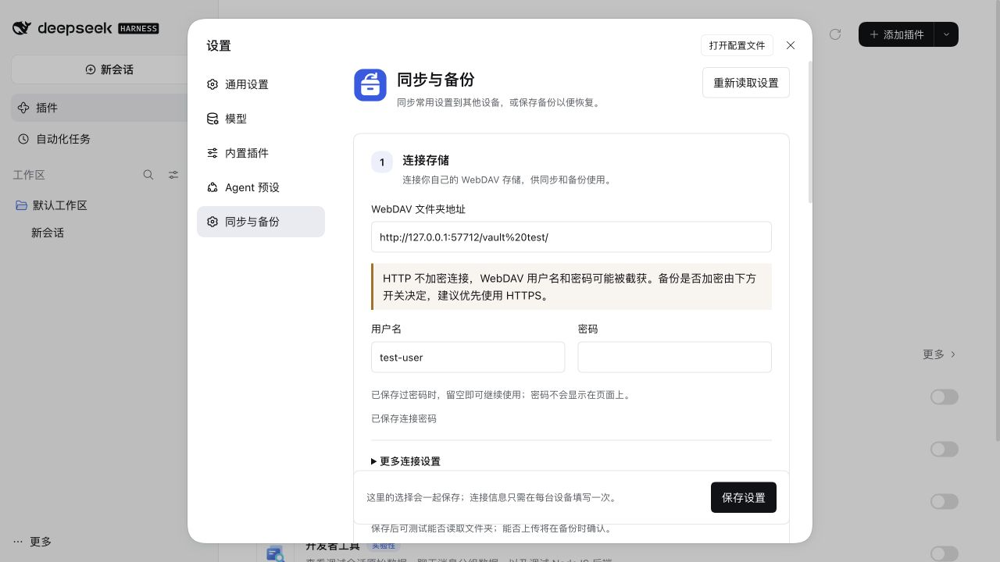
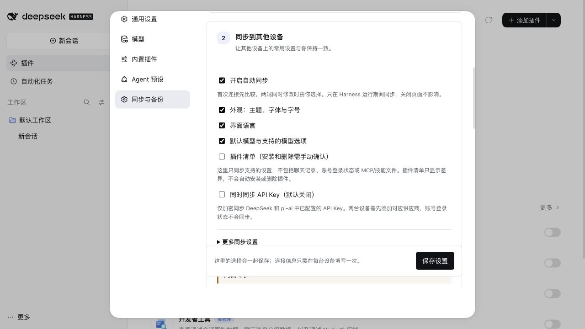
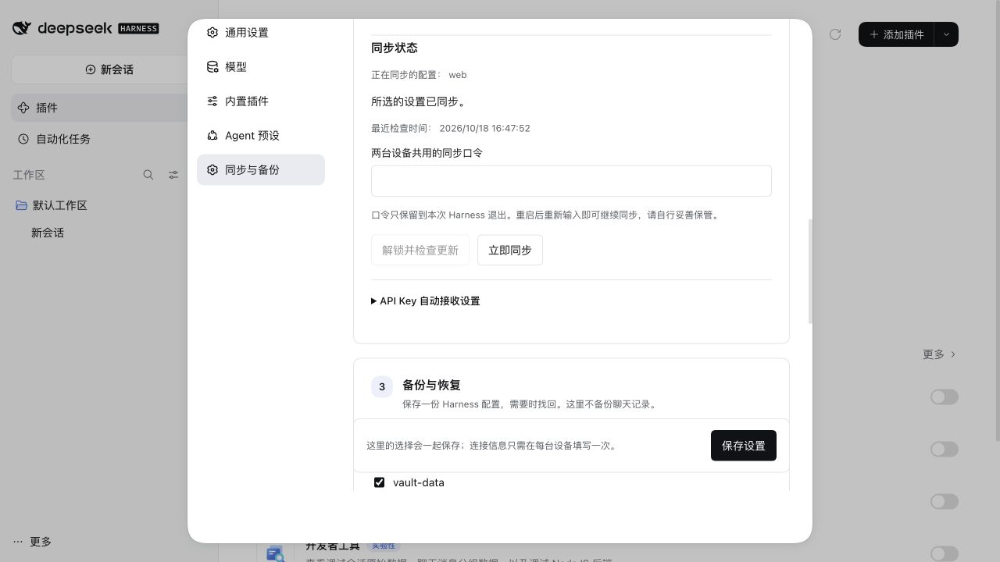
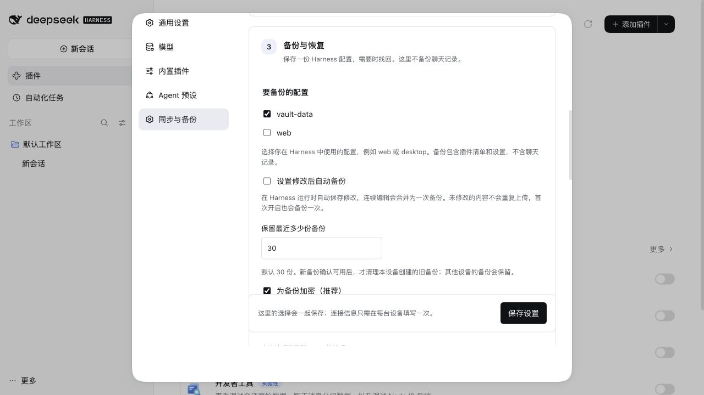
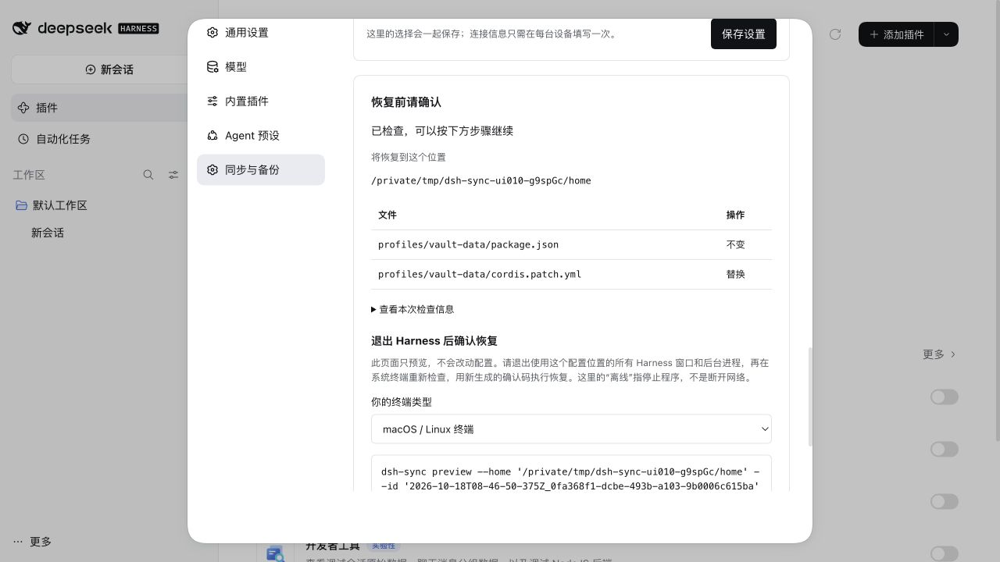

# 0.10.0 设置页重组验收

2026-10-18，使用官方 DSH `0.2.1-rc.2` 运行时，通过真实 DSH CLI 将本地候选包 `@jeweis/dsh-sync@0.10.0` 安装到独立临时 profile。此版本尚未提交、推送或发布。

## 页面变化

- **连接存储**：WebDAV 地址、用户名、密码和连接测试。超时和清除密码放入“更多连接设置”。
- **同步到其他设备**：开启同步、选择内容和独立的 API Key 开关。“更多同步设置”收纳分组与检查间隔。首次比较用中文显示配置名称，空设置显示“使用默认设置”。
- **备份与恢复**：选择配置、自动备份、保留份数、加密、立即备份和备份记录。等待时间、最短间隔和附加文件选择放入“更多备份设置”。
- 底部统一“保存设置”；有未保存修改时，远端操作需先保存。API Key 自动接收设置独立折叠，仍可预览、退出确认和回退。

## 验证结果

| 检查 | 结果 |
| --- | --- |
| 自动化回归 | 124 项通过，覆盖双设备冲突、API Key 隐藏与并发保护、离线恢复和接入回退 |
| 静态检查与打包 | `npm run check`、`npm pack --dry-run` 通过 |
| 发布内容与实际安装 | 已安装客户端与本地构建 SHA-256 一致，量化结果见 JSON |
| 真实页面 | 更多 → 设置 → 同步与备份；三个任务区域正常，技术设置默认折叠 |
| 密钥保护 | API Key 同步默认关闭；页面保留加密要求；密码和口令不回显，操作后口令输入清空 |
| WebDAV | 本地模拟服务的目录在首次备份时自动创建；随后测试显示可读取 |
| 加密备份 | 选择合成配置，上传后校验成功，记录按本地时间显示 |
| 恢复预览 | 备份后修改临时文件，页面显示该文件“替换”，其他文件“不变”；预览前后文件 SHA-256 一致 |
| 恢复确认 | 页面说明退出相关 Harness 进程，终端重新预览、取得新确认码，命令包含 `--confirm PLAN_TOKEN_FROM_CLI --offline`；未执行恢复 |
| 同步 | 保存开关 → 输入测试口令 → 首次比较 → 选择本机 → 确认后显示“所选的设置已同步” |
| API Key 接收引导 | 可展开查看，手动填写 Key 名称默认折叠；没有执行凭据切换 |
| 清理 | 浏览器、临时 Harness、本地 WebDAV 与本次临时 home 已关闭或删除 |

本次仅使用合成配置和测试口令，没有接触真实 profile、模型账号、供应商 Key 或用户的 WebDAV。双设备冲突和密钥同步由自动化回归覆盖，本次真实浏览器验收使用一台临时 Harness，不声称进行了真实双设备或真实 Key 传输。

参考 Harness 源码只读使用，未安装、构建或生成文件；Git 状态保持干净，HEAD `1517a4dbca`。现有数据目录、同步协议、加密及离线确认机制未更改。

[量化记录](acceptance-010.json)

## 截图

