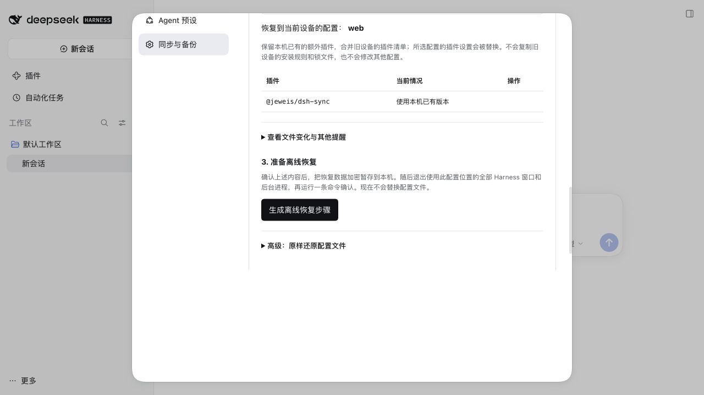

# 0.11.0 新设备接入与恢复验收

2026-10-18。候选包 `@jeweis/dsh-sync@0.11.0`，官方 DSH `0.2.1-rc.2` 独立运行时。本记录编写于首次提交发布之前；其后的设置页精简及 135 项测试验收见 [设置页审查](settings-simplification.md)。

## 真实双 home 场景

1. 在全新的临时 new-home 使用真实 DSH CLI 安装候选 tarball；old-home 使用独立 old-device 配置并启动官方运行时。旧清单中 DSH Sync 来自本地 tarball，新设备使用自己安装的 tarball，模拟不可直接复制的设备路径。
2. 旧配置设置界面语言为 English，备份到本地模拟 WebDAV；确认加密上传成功，备份包含本地依赖提示。
3. 在真实新设备设置页点击“从旧设备恢复”，找到旧备份，输入测试口令。映射 old-device → web，保留新设备已有插件版本，预览通过。
4. 点击生成离线任务，口令输入清空；确认本地保存加密任务，不替换 profile。
5. 停止新设备 Harness，在交互 PTY 执行生成的 `finish-restore` 命令。非交互输入先被明确拒绝；交互输入不回显口令，列出文件变化并要求“确认恢复”。
6. 确认后文件恢复成功，配置补丁与旧设备一致，新设备的插件来源保留，加密 rollback 记录存在，恢复任务被消费，没有 active journal 或 restore lock 遗留。WebDAV 请求数在离线步骤前后均为 10。
7. 重启新设备，浏览器显示 English，证明旧语言配置实际生效，设置可打开。随后仅为截图将临时界面改回中文。
8. 通过真实 CLI 卸载/重装包含最终页面修正的候选包，启动后重新检查向导；复制恢复命令按钮显示“已复制”。客户端构建哈希核对一致。

CLI 不允许把名为 desktop 的 profile 当作 Web 启动，因此验收使用 old-device；桌面 profile 的迁移规则由相同选择/映射代码处理，本次不声称启动了 Electron。

## 自动化覆盖

133 项回归测试通过。新增覆盖包括：

- 旧设备本地插件路径使用新设备已有版本替代；未安装或版本不兼容时列出具体阻碍。
- 常见版本范围及预发布范围解析；安装前确认精确 npm 版本，未确认/过期请求不安装；不启用、不自动批准构建。
- 默认保留本机额外插件与启动 bundle，排除源锁文件和安装规则。
- 两个隔离 home 的加密暂存、离线确认、恢复、回退、过期预览及用户后续修改保护。
- 浏览器向导清空口令、公开状态不含口令、不发出在线 restore。
- 新设备直接接收云端设置，同时保留本机独有项目；原有冲突和 API Key 并发保护保持通过。

另外运行现有 `scripts/acceptance/sync.mjs`，使用两个临时 home 和官方 rc.2 settings、HMR、credentials 服务验证双向同步、首次接入、模型/语言更新和冲突。供应商发现使用固定测试数据，未使用真实 Key；普通引用型 Key 仍需手动接收，记录型 Key 可通过凭据服务同步。

## 限制与隔离

实际浏览器恢复场景复用已安装插件；缺失插件的检查与安装确认由模拟 Harness manager 的契约测试覆盖，未声称从公网下载并执行了未知插件。Windows/PowerShell 未进行实际终端验收。

全部 home、profile、包管理缓存、工作目录和 WebDAV 均隔离；没有访问用户存储、真实 profile 或模型账号。参考 Harness checkout 只读，未安装、构建或生成文件。该版本仍要求退出相关进程后确认完整恢复；本机未安装且无法从可信来源取得的本地插件不会被自动忽略或凭空还原。

[量化记录](acceptance-011.json) · [设计和恢复边界](new-device-recovery.md)

验收浏览器、临时 Harness 和 WebDAV 已关闭，两个临时 home 已删除。参考源码 HEAD `1517a4dbca`，Git 状态干净。
