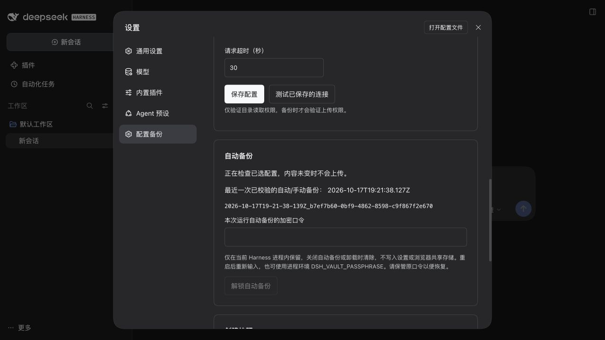
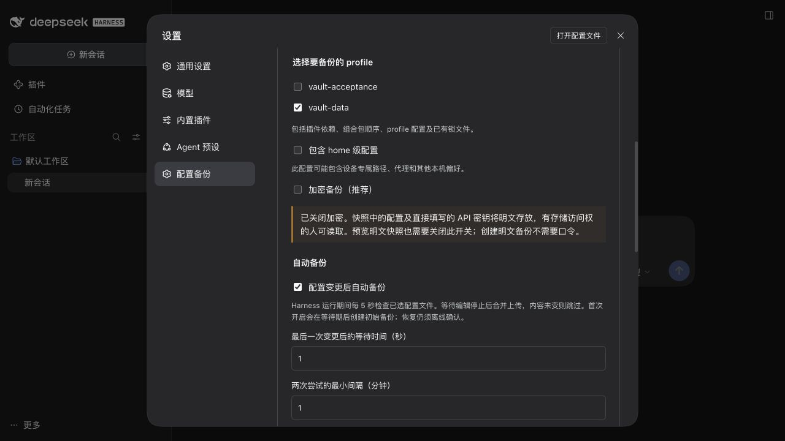
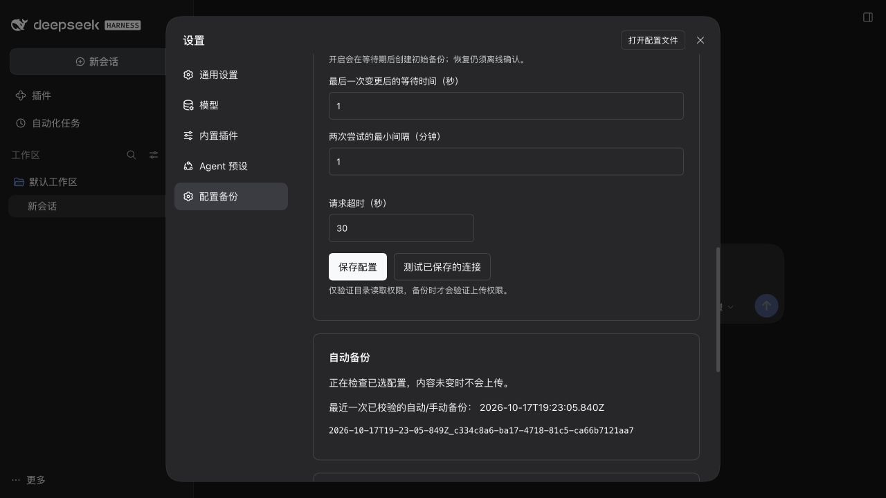

# 0.3.0 功能验收

日期：2026-10-18（Asia/Shanghai）。官方 DSH 0.2.1-rc.2、macOS arm64、Node 24.20.0。只向既有 `/private/tmp/dsh-vault-rc2-acceptance.*` 临时 profile 安装候选归档，运行时来自 npm；参考源码未安装、修改或构建。WebDAV 仅监听本机，固定示例凭据，不使用用户 NAS、账号、真实 profile 或模型 API。

## 真实启动和浏览器

1. 官方 CLI 安装 0.3.0 后成功启动，设置页能加载新的加密与自动开关。
2. 页面开启自动备份，使用测试等待期 1 秒、最小间隔 1 分钟（产品默认 30 秒/5 分钟）；保存后缺少加密口令时明确暂停。
3. GUI 输入示例口令并解锁，输入框清空，宿主自动上传并下载校验成功。
4. 临时 vault-data patch 连续追加两条注释，无手动备份操作；状态显示等待最小间隔，随后只产生一份新加密对象。
5. 停止并重启临时 Harness，开关和范围保留，自动状态重新等待口令，证明会话口令未持久化。
6. GUI 关闭加密并保存，显示明文提示；无口令自动生成一份明文快照，并重新下载校验。
7. GUI 关闭自动备份并保存，独立读取临时设置确认 enabled=false。临时 Harness、WebDAV 和浏览器均关闭。

WebDAV 审计总计 **3 次 PUT、3 个对象**，前两项格式为加密外壳 `dsh-config-vault`，第三项为明文 `dsh-config-vault-snapshot`，未出现额外重复上传。没有从浏览器执行恢复或安装真实 profile。

## 自动化回归

测试使用临时 home 和本机 WebDAV。覆盖连续编辑防抖、限频合并最新内容、忽略凭据/调度文件、正常重启去重、同 home 多实例互斥、手动备份去重、卸载取消、禁用停止、结果不确定后跨重启暂停、明确未上传失败退避、配置保存与轮询竞争、参数校验、默认加密不降级、明文路径/哈希/版本拒绝、明文 CLI 无口令备份/预览、确认恢复仍需加密日志口令，以及构建后的 GUI 开关/解锁/离线命令生成。

自动备份没有多设备合并或在线恢复语义。明文内容缺少加密来源认证，不能把内容哈希当作防篡改保证。真实厂商 WebDAV 与操作系统全矩阵不在本次本机验收范围内。
