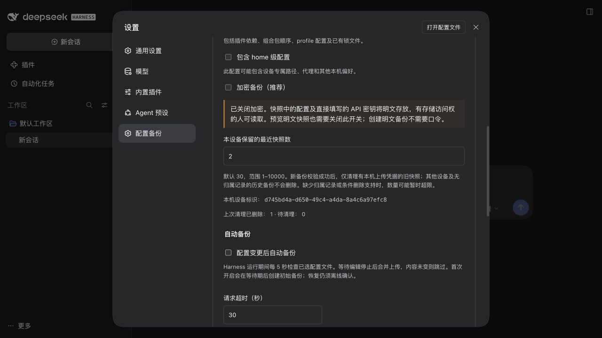

# 0.4.0 保留策略验收

日期：2026-10-18（Asia/Shanghai）。官方 npm DSH 0.2.1-rc.2、macOS arm64、Node 24.20.0。候选包通过官方 CLI 安装到既有 `/private/tmp/dsh-vault-rc2-acceptance.*` 临时 profile，使用本机 WebDAV 和示例账号。未使用用户 NAS 或真实 profile；参考源码保持只读。

## 真实设置页与已安装 CLI

1. 真实 DSH 启动后进入“配置备份”，旧设置缺少 keepLast 时输入框默认显示 30。
2. WebDAV 预置来自另一个全新临时 home/device 的快照。
3. GUI 保存测试上限 2 和本机 WebDAV 地址，创建第一份本设备快照；归属凭据在新对象验证后生成。
4. 用该临时 profile 中实际安装的 0.4.0 CLI 再创建两份示例配置快照，第三份返回 verified=true、keepLast=2、deleted=1、pending=0。
5. WebDAV 审计确认总计 4 次 PUT（1 份其他设备、3 份本设备），只有一次携带 If-Match 的 DELETE，目标是本设备最旧对象。最终保留 2 份本设备对象和 1 份其他设备对象。
6. GUI 重新加载后仍显示数量 2、设备标识、已删除 1、待清理 0；截图使用 2 方便验收，产品默认仍为 30。
7. 临时 Harness、WebDAV 和浏览器关闭。没有恢复写入、线上安装或真实数据删除。

量化证据见 [acceptance-040.json](acceptance-040.json)。

## 自动化回归

在本机临时 home/WebDAV 中验证了默认 32 次备份最终保留 30 份、上传校验失败时零删除、其他设备和伪造远端设备声明不被认领、重启和目的地隔离、改换加密口令后的清理、损坏归属记录拒绝删除、强 ETag 条件删除与 412 替换竞争保护、无/弱 ETag 保留、删除 403 不影响备份成功且下次成功备份重试，以及自动备份和 GUI/CLI 使用同一策略。

没有确认任何真实 NAS 对条件 DELETE 的实现；缺少强 ETag 或协议支持时，产品按设计保留旧文件并报告清理未完成，不承诺远端整个目录总量固定为 30。
