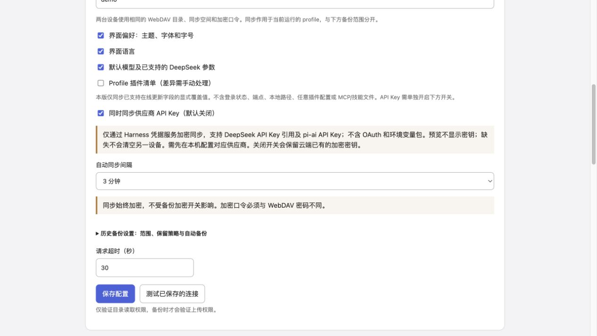
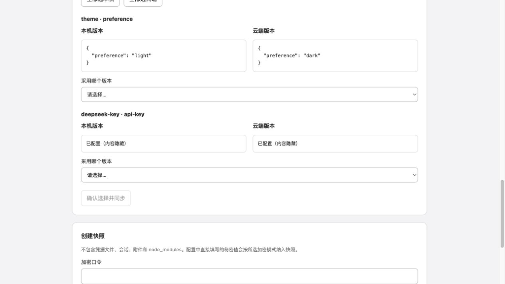

# 0.6.0 API Key 同步验收

历史记录：引用型 Key 的并发限制已在 0.6.1 通过禁止同步写入解决，当前行为见 [0.6.1 验收](acceptance-061.md)。

目标运行时：DSH 0.2.1-rc.2。仅在独立安装的运行时、两个临时 home/profile 和回环 WebDAV 上测试。使用合成 Key，没有真实账号登录、模型请求、真实 profile 安装或用户远端操作。Harness 参考源码保持只读，验收后 `git status --porcelain` 为空，HEAD 为 `1517a4dbca`。

## 验证结果

- `npm test`：94/94 通过，包含设置页、API Key 同步和已有备份、保留、离线恢复回归。
- `npm run check`、`npm pack --dry-run --cache <temporary-cache>` 通过。
- 产物：`dsh-config-vault-0.6.0.tgz`。没有提交、推送、npm 发布或安装到真实 profile。
- 新增测试覆盖：独立默认关闭开关、关闭/锁定时不解析供应商凭据、仅 Key 类别、普通备份明文时仍加密同步、双设备首次确认、Key 引用与记录、单端轮换及重启基线、并发冲突和过期预览、只读服务、缺失不撤销、OAuth 和其他 owner 排除、保留接收端 env、原子回调中的并发轮换、共用引用同值只写一次/异值写前拒绝、错误脱敏与失败后加密 pending。

## 官方 rc.2 实际服务

复现方式：`DSH_VAULT_TEST_RUNTIME=<independently-installed-runtime> node --expose-internals scripts/acceptance/sync.mjs`。

脚本为两个临时 profile 启动官方 Boot、Settings、ConfigEditor、HMR、主题、语言、默认模型和 `dsh-credentials-local`。显式指定临时凭据 home，关闭凭据监听，提供空 launch environment，不继承个人 API Key。供应商发现使用固定的两条配置视图夹具，没有挂载真实模型适配器或访问模型网络；凭据和设置读写、磁盘文件、HMR 是真实官方服务。因此这是官方服务集成验收，不是实际两台物理设备或完整模型请求验收。

结果：

```json
{"realCredentials":true,"referenceAndRecordKeys":true,"keyRotation":true,"providerDiscoveryFixture":true,"runtime":"0.2.1-rc.2","devices":2,"realSettings":true,"hmr":true,"firstJoinPreview":true,"bidirectional":true,"conflictResolution":true,"sameFiber":true,"defaultModel":true,"language":true,"remoteObjects":1}
```

## 设置页

构建后的实际 lazy-CJS 页面在回环预览服务中检查。界面默认开关行为另由 jsdom 组件测试验证；下图为已显式开启的隔离夹具。浏览器只收到 `configured` 布尔值，不收到 Key、Key 片段或 Key 哈希。预览服务和浏览器测试页均已关闭。





## 边界

仅支持当前文档列出的官方 DeepSeek 和 pi-ai Key，不同步 OAuth 或环境变量包；不会自动安装供应商插件。关闭开关不会清除云端已有加密密钥及本机加密操作历史。凭据由 Harness 服务管理，通常同一 DSH_HOME 的多个 profile 共享，更新某个引用/记录会影响使用它的其他 profile。完整快照恢复继续离线确认。

`modifyRecord` 的当前值核对在原子回调中完成；引用型 `set` 没有公开 CAS，虽然有预览绑定、写前重读和写后校验，仍不能排除其他进程在最后重读与写入之间更新同一引用的极短窗口。详见 [同步范围与安全边界](device-sync.md)。
