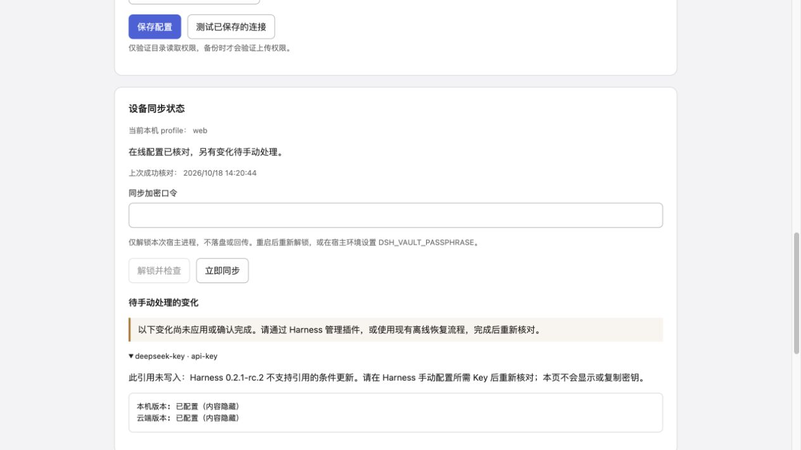

# 0.6.1 引用型 API Key 防覆盖验收

历史记录：0.7.0 增加可选原子 provider，托管引用可安全自动接收；普通 provider 仍保留本文保护。见 [0.7.0 验收](acceptance-070.md)。

本次消除的是同步写入覆盖用户新 Key 的路径：Harness 0.2.1-rc.2 的引用 API 没有 CAS，插件现在完全不对供应商引用调用 `credentials.set/unset`。没有使用仅约束插件的锁、反复重读或补偿回滚来冒充原子更新。参考源码保持只读，不访问真实 profile 或用户远端。

## 行为变化

- 引用型 Key 保留加密上传；接收云端变化只列为待手动处理。目标为空、首次加入、并发冲突中选择云端、自动检查以及重新核对均不例外。
- 设置页明确显示“云端（需在 Harness 手动配置）”。选择后只保存加密待处理状态，不修改凭据，也不把未应用的引用记为同步成功。
- 待处理跨轮询和重启保持；本机/云端均未变化时不重复首次选择。用户在 Harness 手动配置成相同 Key 后，重新核对才建立基线；改成其他 Key 会重新比较。
- pi-ai 的 Key 记录仍通过 `modifyRecord` 原子回调核对当前值并更新，保留接收端 env；不扩大到引用、OAuth 或凭据文件操作。
- API Key 开关仍默认关闭，始终加密，页面只显示配置状态。完整快照恢复继续离线确认。

## 测试

`npm test`：96/96 通过。修改后的设置页另经 15/15 客户端测试验证。`npm run check`、打包预检查通过，生成 `dsh-config-vault-0.6.1.tgz`；未发布、提交或安装。

竞争回归在最后一次 `resolve` 返回旧值时立刻模拟另一写入者保存新 Key，分别覆盖 DeepSeek 引用、pi-ai 引用和空目标。对 `set` 安装失败陷阱，确认同步从未调用，用户新值保留。另验证待处理跨重启、未应用的基线不确认、手动匹配后继续，以及 Key 记录并发轮换保护。

真实服务复验使用独立安装的 rc.2 运行时、两个临时 home/profile、空 launch environment 和本机 WebDAV。供应商发现为固定视图夹具，凭据、Settings、HMR 和磁盘由官方服务处理，没有模型网络请求。运行命令：

```sh
DSH_VAULT_TEST_RUNTIME=<independently-installed-runtime> node --expose-internals scripts/acceptance/sync.mjs
```

结果：

```json
{"realCredentials":true,"referencesNeverOverwritten":true,"manualReferenceResume":true,"atomicRecordRotation":true,"providerDiscoveryFixture":true,"runtime":"0.2.1-rc.2","devices":2,"realSettings":true,"hmr":true,"firstJoinPreview":true,"bidirectional":true,"conflictResolution":true,"sameFiber":true,"defaultModel":true,"language":true,"remoteObjects":1}
```

## 页面检查

使用构建后的 lazy-CJS 页面和合成凭据。选择“全部选云端”并确认后，主题可应用，引用型 Key 保留本机值并进入待手动处理；页面不显示 Key。临时页面和预览服务已关闭。



限制：本版不再提供引用型 Key 的自动接收，包括首次空目标。若需要引用型 Key 安全自动双向写入，需要 Harness 提供原子条件更新接口；插件不能在保持当前公开接口和源码只读的条件下补足这一保证。记录型 Key 的自动双向同步不受影响。
