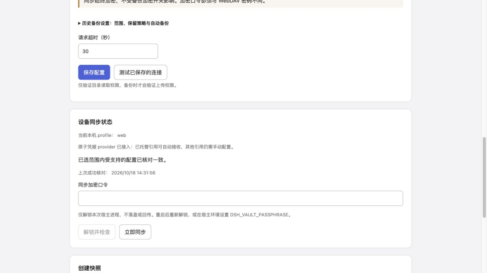

# 0.7.0 可选原子凭据 provider 验收

目标：无需改 Harness 源码，为已托管引用保留自动接收，并通过与用户保存共用的官方事务避免过期覆盖。普通 provider 的引用仍保留手动保护。所有实际测试只使用临时 home/profile、合成 Key 和本机 WebDAV，没有安装到真实 profile，没有用户远端、真实登录或模型调用。

## 完成结果

- `npm test`：103/103 通过。
- `npm run check`、`npm pack --dry-run` 通过。可选入口为 `dsh-config-vault/credentials-provider`，默认 bundle 不加载它。
- 实际官方 rc.2 Boot 加载扩展后，两个临时 profile 可确认首次引用接收，并自动传播后续轮换；主题、语言、模型选择和冲突仍通过实际 Settings/HMR 工作。
- 另用普通官方 provider 复验：引用接收仍为待手动处理，不因扩展存在就调用无条件 `set`。
- 没有提交、推送、发布或自动接入真实 profile。

## 竞争测试

测试使用官方 `LocalCredentialProvider`，独立进程共享同一临时凭据存储，关闭 watcher 以排除恰好及时刷新缓存的假象。

1. 用户进程在同步快照后保存新 Key：CAS 在事务内重新读取实际存储并拒绝旧版本，保留用户值。
2. CAS 在事务回调中持锁暂停，另一个进程开始用户保存：用户写入等待同一文件锁，CAS 完成后用户值最终生效。
3. 同一值再次保存、unset、环境回退和旧 `refs` 初始回退：generation/生效值按预期变化，取消配置不会复活旧保存值。
4. 用户在下一次自动检查前重新保存相同 Key，且云端有更新：本机版本基线识别保存动作，产生冲突，不自动覆盖。
5. 普通 provider 待处理状态接入扩展后，先重新比较；经确认才接收。未托管引用和保留引用不获得 CAS 能力。
6. 只读原子快照与缓存读取不重写凭据存储；配置错误、私有记录损坏和过期预览均拒绝写入。

## 真实启动集成

```sh
DSH_VAULT_TEST_RUNTIME=<independently-installed-runtime> DSH_VAULT_TEST_ATOMIC_REFS=1 node --expose-internals scripts/acceptance/sync.mjs
```

结果：

```json
{"realCredentials":true,"referencesNeverOverwritten":true,"atomicReferenceReceiving":true,"manualReferenceResume":false,"atomicRecordRotation":true,"providerDiscoveryFixture":true,"runtime":"0.2.1-rc.2","devices":2,"realSettings":true,"hmr":true,"firstJoinPreview":true,"bidirectional":true,"conflictResolution":true,"sameFiber":true,"defaultModel":true,"language":true,"remoteObjects":1}
```

去掉 `DSH_VAULT_TEST_ATOMIC_REFS=1` 再次执行，得到 `atomicReferenceReceiving:false`、`manualReferenceResume:true`，普通 provider 的保护通过。

供应商发现仍为固定设置视图夹具，没有挂载真实模型适配器或发送模型请求；Boot、凭据 provider、跨进程存储、Settings 与 HMR 是实际官方服务。此结果不是两台物理设备或真实模型请求验收。

## UI 与性能

`DSH_VAULT_PREVIEW_ATOMIC=1 npm run preview:sync` 的回环页面使用实际原子 provider 和适配器，供应商/主题视图为夹具。选择全部云端并确认后，同步完成，Key 始终隐藏。页面和临时预览服务已关闭。



合成数据性能测量：1000 次缓存解析总计 9.50 ms；100 次只读原子快照总计 18.88 ms；凭据文件 mtime 未变化。没有新增定时器，远端默认仍每 3 分钟检查。数字只代表这台设备的测试，不作普遍性能保证。

## 必须保留的边界

这是可选 provider 接入方案，不能给现有普通 provider 凭空加上 CAS。必须让同一引用的全部写入 profile/进程使用相同托管配置与凭据存储；旧 provider 或直接编辑旧 `refs` 会绕过协调机制，不能承诺保护这些写入。不能统一写入入口时继续普通 provider 的手动接收。

托管记录持久保留，退出或降级不会自动搬回旧 `refs`，切回旧 provider 可能启用旧值。实际接入与退出说明见 [原子凭据 provider](atomic-credentials.md)；本次没有执行真实接入、凭据迁移或降级。完整快照恢复仍离线确认。
