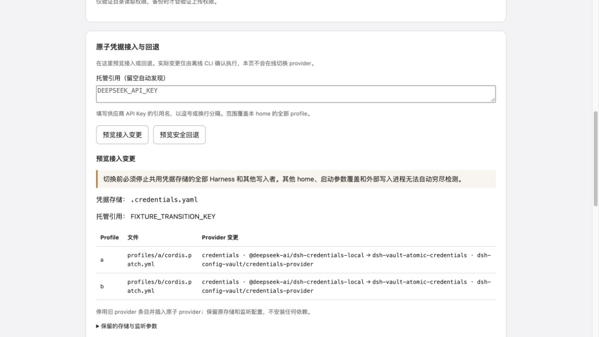
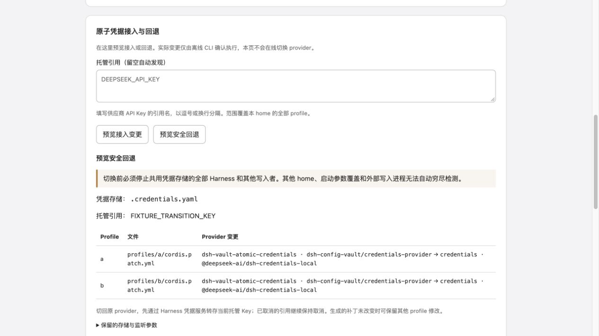

# 0.8.0 接入引导与离线回退验收

目标运行时：DSH 0.2.1-rc.2。参考源码只读；仅使用临时 home/profile、独立安装运行时、合成 Key 与回环页面。没有真实 profile 安装、用户远端请求、真实登录、模型调用、提交或发布。

## 测试结果

- `npm test`：116/116 通过；包含原子同步、备份、保留策略、原有离线恢复和新接入引导回归。
- 构建后的设置页验证：发现全部 profile、显示接入/回退变更与保留参数、生成离线命令；POST `provider-switch` 被拒绝，网页不写入 profile 或凭据。
- 新测试覆盖：新鲜 token 与双停止声明、Key/配置变化导致计划过期、保留最新 Key、unset 不复活旧 Key、保留无关配置、精确清理内部记录、部分接入中断、部分回退中断、安全重试、与快照恢复互斥、错误/路径/符号链接阻断。
- `npm run check`、`npm pack --dry-run` 通过，产物 `dsh-config-vault-0.8.0.tgz`。

## 实际 Boot 重启验收

```sh
DSH_VAULT_TEST_RUNTIME=<independently-installed-runtime> node --expose-internals scripts/acceptance/provider-switch.mjs
```

同一临时 home 内创建 web/headless 两个 profile，实际启动官方 Boot、ConfigEditor、Settings 和原凭据服务。先在线只读预览，再停止两个上下文、用新 token 离线切换并重启；更新 Key 和主题后，停止两个上下文、安全回退并再次重启。两端都回到原 provider，读到更新后的 Key，主题修改保留。

结果：

```json
{"runtime":"0.2.1-rc.2","profiles":2,"readOnlyOnlinePreview":true,"offlineSetup":true,"restartedAtomicProvider":true,"latestKeyPreserved":true,"unrelatedSettingsPreserved":true,"offlineRollback":true,"restartedOriginalProvider":true,"sourceModified":false,"realProfileTouched":false}
```

用于字面量引用发现的 DeepSeek 行因夹具没有提供 `llm` 服务而保持 pending，启动会报告此项。凭据、Settings 和 provider 切换/重启真实执行；没有做真实模型连接验收。单元测试的解析 anchor 为合成目录，实际 Boot 脚本使用真实已安装 rc.2，两者验证范围不同。

## 界面

回环预览使用真实设置页 bundle、实际预览服务与两个临时 profile。先检测后只展示计划；浏览器没有执行切换。回退夹具已在打开页面前完成临时接入并更新合成 Key。页面与预览服务器均已关闭。





限制及实际接入步骤见 [接入与回退](provider-onboarding.md)。本功能不穷尽探测外部写入者，不支持 home 外共享存储或复杂动态配置，也不会在网页中在线替换凭据 provider。
