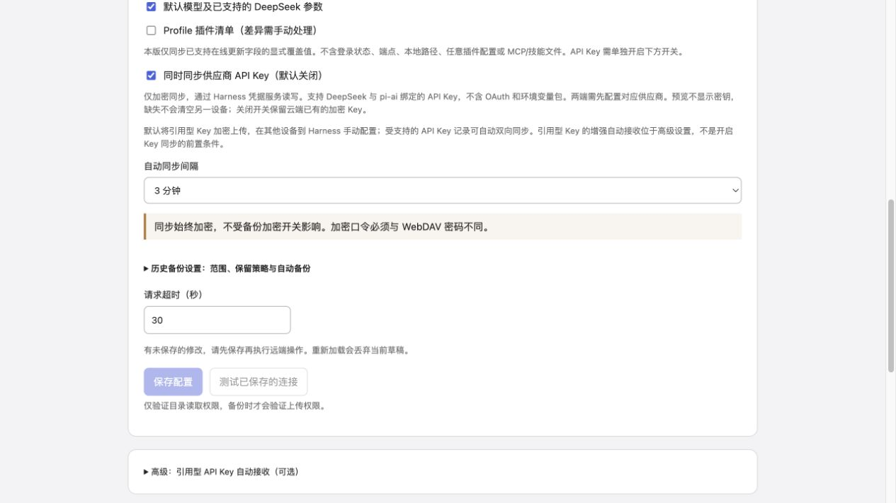

# 0.8.1 默认接入流程简化验收

本次仅调整设置页流程与文案，保留现有凭据服务接口、同步协议、原子扩展及离线恢复逻辑。

## 行为

- 默认使用现有 Harness 凭据服务；常规配置同步、备份、Key 加密上传无需接入扩展或退出。
- API Key 同步独立开关，默认关闭，只允许加密同步。开启后说明引用型 Key 的默认接收需在 Harness 原生界面配置，受支持的 Key 记录仍可自动双向同步。
- 凭据扩展位于默认折叠的“高级：引用型 API Key 自动接收（可选）”。首次展开才挂载引导，不请求预览或写配置；收起保留本次输入与预览。嵌套折叠事件不改变外层状态。
- 已有扩展能力在折叠标题显示状态。关闭高级面板或 Key 同步不会卸载扩展；回退仍需预览、停止所有写入者和离线新 token 确认。
- API Key 未开启时，常规同步状态不展示凭据接收模式。完整恢复继续离线确认。

## 验证

- `npm test`：117/117，包括默认折叠、展开零请求、保存 Key 同步不触发切换、两种模式的接收提示，以及原有并发保护、回退和中断恢复测试。
- `npm run check`、`npm pack --dry-run` 通过。
- 实际发布的 DSH 0.2.1-rc.2：独立安装运行时、两个临时 home/profile、本机模拟 WebDAV；运行 `scripts/acceptance/sync.mjs`。配置双向同步、首次比较、冲突选择、HMR、语言和默认模型通过；引用型 Key 未覆盖且保持手动接收，Key 记录轮换通过。供应商发现为固定测试夹具，设置/凭据/HMR 使用实际服务。
- 浏览器：最终 lazy-CJS 构建可打开；API Key 默认关闭，开启后显示默认接收说明，高级接入默认收起，展开/收起正常。图中为临时页面的未保存草稿，不是修改真实设置。
- 全部使用合成凭据和临时 profile；未访问用户远端，未安装到真实 profile。Harness 参考源码保持干净，HEAD `1517a4dbca`。

