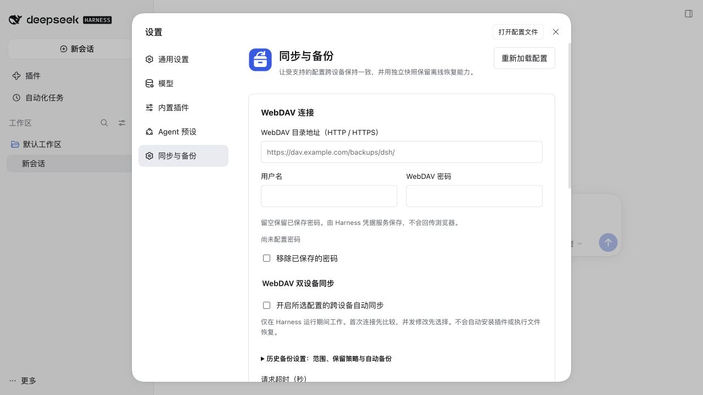

# npm 0.9.1 实际安装与设置页验收

日期：2026-10-18（Asia/Shanghai）。包 `@jeweis/dsh-sync@0.9.1`，官方发行运行时 DSH `0.2.1-rc.2`。本次验证 npm 已可用，以及发布包的安装、启用、真实设置页和重启持久化；不是本地源码链接，也不是模拟设置页。

## 结果

| 项目 | 结果 |
| --- | --- |
| npm 官方元数据 | 可读取 name、version、tarball、SHA-512、两个 CLI 入口 |
| 实际下载和安装 | 通过真实 DSH CLI，从 npm 官方源安装精确版本成功 |
| 包完整性 | 临时 profile 的 pnpm-lock.yaml integrity 与 npm 官方 SHA-512 一致 |
| 设置页构建 | 发布包自带 81,587 字节客户端，安装时无需运行插件构建脚本 |
| 插件列表 | 显示中文名称、说明和图标，可打开“启用 同步与备份”开关 |
| 界面路径 | 更多 → 设置 → 同步与备份，WebDAV、同步、历史备份与快照区域正常加载 |
| 重启 | 停止再启动同一临时 profile 后，启用状态保留，设置页仍可打开 |
| 清理 | 验收浏览器标签页与本次 Harness 服务均已关闭 |

量化结果见 [JSON 记录](acceptance-npm-091.json)。

## 安装与启用的区别

实际 CLI 安装使用：

```sh
# 在显式隔离的 DSH_HOME / DSH_AGENTS_HOME 中执行，勿误用真实 home。
dsh plugin --profile web add @jeweis/dsh-sync@0.9.1 --ignore-scripts --registry=https://registry.npmjs.org/
```

CLI add 下载了包，但最初并未启用它。启动临时 Harness 后，在“插件 → 已安装插件”里打开“同步与备份”的开关，Harness 将包加入临时 profile 的 bundle 列表，随后无需手写 YAML 即出现设置页入口。本次还验证了该启用操作在重启后保留。

## 隔离与工具链

DSH_HOME、DSH_AGENTS_HOME、profile、npm/pnpm 缓存、配置和启动 cwd 均位于专用临时目录。运行时复用先前独立安装的官方 rc.2 包，只读使用；没有在参考源码中安装、构建、更新或生成文件。参考源码 Git 状态干净，HEAD 为 `1517a4dbca`。

首次 Corepack 选择了 pnpm 12，其原生执行程序首次引导出现等待，最终改用仅安装在本次临时目录的 pnpm `10.34.7` 完成完整 DSH CLI 操作。切换前的临时 node_modules 被移出 profile，避免 store 主版本冲突；未修改系统 pnpm。这是验收工具链问题，不是插件版本不兼容。

没有登录模型账号、添加供应商 Key、发起模型调用，或访问个人 WebDAV。此次不重复测试 WebDAV 上传、恢复覆盖或跨设备同步；这些能力的既有验收与本次安装/打开设置页分开记录。


