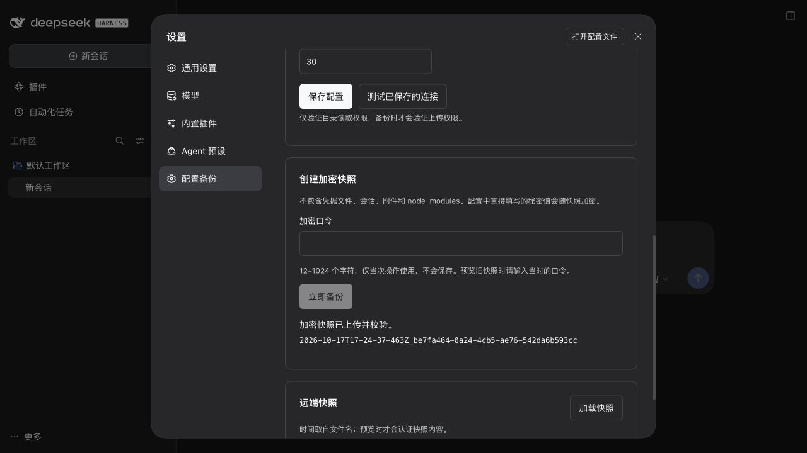
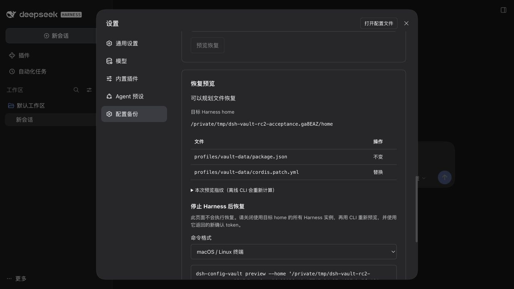

# DSH 0.2.1-rc.2 完整启动验收

日期：2026-10-18（Asia/Shanghai）。环境：macOS arm64、Node 24.20.0，官方 npm `@deepseek-ai/dsh@0.2.1-rc.2`。验收插件为打包后的 `dsh-config-vault@0.2.2`，通过真实 DSH CLI 安装到全新的临时 profile，不使用参考源码构建产物或模拟页面。

## 隔离范围

运行时、DSH_HOME、DSH_AGENTS_HOME、profile、Corepack/pnpm、用户配置和缓存均放在同一 `/private/tmp/dsh-vault-rc2-acceptance.*` 临时目录。启动器只传入必要环境，未继承个人 API Key。共享参考源码保持只读，未修改、安装、构建或更新。没有安装或启动真实 profile，没有模型调用、真实账号登录或外部 WebDAV 操作。

WebDAV 使用仅监听 127.0.0.1 的 HTTPS 服务器、随机 Basic Auth 测试密码和一次性 localhost 证书。仅通过验收进程的 NODE_EXTRA_CA_CERTS 信任该证书，没有关闭证书校验，也没有修改系统信任。UI 操作使用真正的 rc.2 Web 页面。

## 实际结果

| 项目 | 结果 |
| --- | --- |
| 官方运行时版本 | CLI 输出 0.2.1-rc.2 |
| 临时 Web profile | 从 web 模板初始化，官方 CLI 安装 tgz，成功启动 |
| 设置页入口 | 设置 → 配置备份，可正常加载表单 |
| 连接和范围持久化 | GUI 保存后重启，URL、用户名、vault-data 选择和已配置密码状态保留 |
| HTTPS WebDAV | 真实宿主进程凭据解析、TLS 校验和目录测试通过 |
| 加密备份 | GUI 上传后重新下载并校验，提示成功；远端 1 个独立加密对象 |
| 快照内容 | runtimeVersion 为 rc.2，仅含 vault-data 的 package.json 和 patch，不含凭据、口令或本机设置文件 |
| 快照列表 | GUI 成功列出实际上传的对象 |
| 恢复预览 | 修改临时测试 patch 后，GUI 显示 package.json 不变、patch 替换，无版本阻塞 |
| 错误口令 | GUI 拒绝并清除旧预览，输入框清空 |
| 预览只读 | 预览前后目标文件 SHA-256 相同，无 active.vault 或 restore.lock |
| 本地依赖阻塞 | 对实际含本地 tgz 依赖的启动 profile 采集和预览，正确报告 local-dependency 并阻止应用 |
| 鉴权 | 未认证访问实际状态 API 返回 HTTP 401 |
| 离线 CLI | 停止 Harness 后，用已安装插件 CLI 下载同一快照，预览成功且不改目标文件 |
| 代码一致性 | 已安装 Host 源码与客户端 bundle 的 SHA-256 与候选源码/产物一致 |

量化证据见 [acceptance-rc2.json](acceptance-rc2.json)。GUI 验收没有执行恢复覆盖；后续离线 CLI 验收在另一组全新临时目标中执行了恢复和回滚，见下节。临时应用和 WebDAV 在验收后停止。

## 离线恢复与回滚补充验收

通过先前真实 rc.2 profile 中安装的 **0.2.2 CLI**，对另一台本地临时 HTTPS WebDAV 和全新临时目标执行完整命令往返。不是直接调用库函数。

| 项目 | 结果 |
| --- | --- |
| backup / list | 实际上传认证加密快照并从远端列出 |
| 现有配置恢复 | preview 显示两项替换；正确 token + offline 后逐字节等于源文件 |
| 离线与确认门禁 | 缺少 offline、错误 token 均失败，目标内容不变 |
| 保留回滚 | 日志不包含明文配置或口令，recover 预览后确认，逐字节还原原文件 |
| 新 home 恢复 | 两项 create，恢复后逐字节等于源文件 |
| 新 home 回滚 | 删除由本次事务新建的文件，还原原本不存在的状态 |
| 事务收尾 | 两个目标均无 active.vault 和 restore.lock 遗留 |

证据见 [acceptance-offline.json](acceptance-offline.json)。恢复返回 dependenciesInstalled: false；此验收使用无额外插件依赖的配置，不宣称执行了用户插件依赖重装。实际 Cordis 工具注册、异常回滚、中断事务恢复、后续编辑冲突保护、篡改/路径/版本拒绝、连接超时等由 36 项自动化测试覆盖。第一版交付范围为手动 WebDAV 快照、设置页和离线恢复；S3、双向同步、定时任务、Skills 和凭据迁移保留为后续功能。





## 发现并修复的问题

1. **0.2.1 的状态 GET 返回 HTTP 400。** 原来单一路由的 requestBody 为 streaming，rc.2 的实际 node:http → Request 桥接为 GET 附加 body，违反 WHATWG Request 要求；直接调用 Fetch handler 的库测试没有覆盖此路径。0.2.2 将 GET 状态读取拆到 `/api/dsh-config-vault/state` 并使用 buffered，将有 32 KiB 限制的 POST 动作保留在 `/api/dsh-config-vault` 的 streaming route。新增路由模式回归断言，并重新安装归档后通过真实 Web 页面验证。
2. **深色主题主按钮出现浅底白字。** 0.2.2 改用 Harness 的 button-primary-fill / label-primary-foreground 配对 token，真实深色页面的保存/备份按钮可读。

请更新到 0.2.2；0.2.1 不包含这两个完整集成验收修复。

## 重现方式

从插件目录执行，需 Node、npm、OpenSSL 和下载官方依赖的网络权限。以下命令只操作新建的临时目录，不要替换成个人 DSH_HOME：

```sh
export DSH_VAULT_ACCEPTANCE_DIR="$(mktemp -d /private/tmp/dsh-vault-rc2-acceptance.XXXXXX)"
npm install --prefix "$DSH_VAULT_ACCEPTANCE_DIR/runtime" --ignore-scripts @deepseek-ai/dsh@0.2.1-rc.2
node scripts/acceptance/setup.mjs
npm pack
node scripts/acceptance/run-dsh.mjs --profile vault-acceptance --from-default-profile web --dump-config
node scripts/acceptance/run-dsh.mjs plugin --profile vault-acceptance add "$PWD/dsh-config-vault-0.2.2.tgz" --ignore-scripts
```

另一终端使用同一 DSH_VAULT_ACCEPTANCE_DIR 启动 `node scripts/acceptance/webdav.mjs`，它会输出 HTTPS 地址，并把仅供验收的随机密码保存到该临时目录的 `webdav/credentials.json`。再启动：

```sh
node scripts/acceptance/run-dsh.mjs --profile vault-acceptance --no-open --host 127.0.0.1 --port 0
```

打开打印出的认证 URL，跳过模型登录，进入设置 → 配置备份。选择 vault-data（取消不存在的默认 web 选择），填入本地 WebDAV 地址和测试凭据，保存/测试/备份/列表/预览。仅在临时 vault-data patch 增加一条注释即可验证“替换”预览。结束时关闭浏览器并对应用及 WebDAV 按 Ctrl+C。

这是本机官方 rc.2 + 本地 HTTPS WebDAV 的验收，不代表 Nextcloud、坚果云、NAS、所有操作系统或后续 DSH 版本均已验收。

若需重复离线恢复验收，另外新建一组临时目录，运行 setup.mjs 与 webdav.mjs 后，在插件目录执行：

```sh
# CLI 必须来自此前临时 rc.2 profile 中已安装的插件，不接受真实 profile 路径。
export DSH_VAULT_ACCEPTANCE_CLI=/private/tmp/dsh-vault-rc2-acceptance.PREVIOUS/home/profiles/vault-acceptance/node_modules/dsh-config-vault/src/cli.mjs
node scripts/acceptance/offline.mjs
```

该脚本拒绝已有恢复目标，自动运行备份、列表、预览、拒绝路径、确认恢复、回滚，并写入非秘密 offline-evidence.json。结束后停止 WebDAV。
